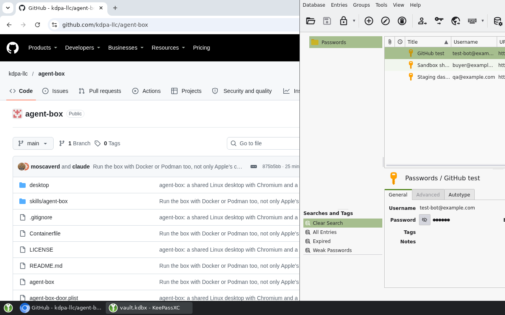

<div align="center">

# 🖥️ Agent Box

### A computer for your AI agents. You watch, and take over from your phone.

Give Claude Code, Codex and other coding agents their own Linux desktop with a real Chromium, saved logins and a password vault. Agents drive the browser with Playwright; you watch in any browser and take over whenever a step needs a person. It runs on your Mac or Linux machine, and only while it's used.

[![npm version][npm-version-badge]][npm-package]
[![npm downloads][npm-downloads-badge]][npm-package]
[![Node.js 18+][node-badge]][nodejs]
[![CI][ci-badge]][ci-workflow]
[![CodeQL][codeql-badge]][codeql-workflow]
[![License: MIT][license-badge]][license-file]
[![Platform: macOS | Linux][platform-badge]](#-choose-a-container-tool)
[![Agent Skills][skills-badge]][agent-skills]

[![GitHub Stars][stars-badge]][stargazers]
[![GitHub Issues][issues-badge]][repo-issues]
[![GitHub Last Commit][commit-badge]][commits]
[![PRs Welcome][prs-badge]][contributing]

[🚀 Quick start](#-quick-start) · [🧰 Container tools](#-choose-a-container-tool) · [🔐 Passwords](#-passwords) · [⌨️ Commands](#️-cli-reference) · [💖 Support](#-support-the-project)



</div>

Coding agents are good at the web until a site wants a login, blocks headless browsers, or needs a person for a CAPTCHA. Agent Box gives them a browser that behaves like yours: it keeps cookies, shows a real screen, and lets you step in. It's the same recipe as Anthropic's computer-use demo and E2B's desktop sandbox, packaged as one command for the machine you already have.

- 🖥️ **A real desktop**: Linux, Chromium and a taskbar, viewable in any browser.
- 🤖 **Driven with Playwright**: agents use `playwright-cli` over Chromium's remote-control port instead of clicking on pixels, with desktop screenshots and mouse and keyboard control when they need them.
- 📱 **Watch and take over from your phone** through the web viewer and Tailscale.
- 🔐 **Passwords agents don't see**: a KeePassXC vault inside the box. Agents type entries into the page without the values reaching their output.
- 🍪 **Logins that persist** between runs.
- 💤 **Runs only while used**: starts in seconds and stops itself after 20 idle minutes.
- 🧩 **Agents already know how to use it**: setup adds an [Agent Skill][agent-skills] for Claude Code, Codex and others.

> [!IMPORTANT]
> The vault keeps passwords out of agents' chats, commands and logs, but it isn't a wall against them: they control the box, so one that sets out to read a password can. Store only test or low-risk accounts there, never your email, bank or cloud admin accounts. See [🛡️ Security and privacy](#️-security-and-privacy).

## 🧰 Choose a container tool

The box runs in a container. You need Node and one of these:

| Container tool                  | Runs on                                       | Cost                     | Notes                                                                                                                                                         |
| ------------------------------- | --------------------------------------------- | ------------------------ | ------------------------------------------------------------------------------------------------------------------------------------------------------------- |
| 🍎 **Apple's `container`**      | Macs with Apple silicon and macOS 26 or later | Free, open source        | **The default there.** Each box is its own small VM, and all its memory comes back when it stops. Setup installs it with Homebrew.                            |
| 🐳 **Colima** with Docker       | Macs, Linux                                   | Free, open source        | `brew install colima docker`, then `colima start`. Its VM stays on after the box stops, until `agent-box off`.                                                 |
| 🐳 **Docker Desktop, OrbStack** | Macs                                          | Paid for some businesses | Docker Desktop is paid for companies with 250 or more people or $10M or more in revenue; OrbStack is paid for commercial use. The VM stays on, like Colima's. |
| 🐧 **Docker Engine, Podman**    | Linux                                         | Free, open source        | No VM at all: the box is a plain container. Good for an always-on Linux server.                                                                               |

CI tests Docker on Linux (x64 and arm64) and Podman on every change. Apple's `container` is tested by hand, since GitHub's Mac runners can't run it.

## 🚀 Quick start

### 1. Install

**Through your agent:** open a session in your coding agent (Claude Code, Codex, T3 Code or similar) and paste this line:

```text
Install agent-box from https://github.com/kdpa-llc/agent-box by following the Quick start section of its README.
```

The agent installs it, and asks you which container tool to use if you have more than one, and where to add its skill.

**By hand:** run these two commands in a terminal. `setup` asks you the same questions.

```bash
npm install -g agent-box
agent-box setup
```

To try the latest `main` before it's released, install from GitHub instead with `npm install -g --allow-git=root github:kdpa-llc/agent-box`. npm 12 refuses installs from GitHub unless you pass `--allow-git=root`, which allows only this package.

> **🤖 Agents doing the install:**
>
> 1. Check the machine has Node and can run one of the container tools above: `uname -sm`, `sw_vers` on a Mac, and `command -v container docker podman`. If none fits, show the user the table and stop.
> 2. If more than one tool fits, ask the user which to use. Apple's `container` is the default on Macs that can run it; Docker or Podman must already be running.
> 3. Ask the user where to add the `agent-box` skill; it's how agents learn to use the box. The defaults are the Claude Code skills folder (`$CLAUDE_CONFIG_DIR/skills`, or `~/.claude/skills` when that's unset) and `~/.agents/skills`, which Codex and other agents read. They may instead name other folders, or say none.
> 4. Run `npm install -g agent-box` (if npm can't find the package, use `npm install -g --allow-git=root github:kdpa-llc/agent-box`). Then run `agent-box setup --runtime <tool>`, adding `--skills-dir <folder>` once for each folder they named, `--no-skills` for none, or nothing for the defaults. The first setup takes 1 to 3 minutes.
> 5. Tell the user what setup printed, and that new agent sessions will know the box.

`agent-box setup` is safe to run again. It:

- installs `playwright-cli` (npm) if it's missing, and Apple's `container` (Homebrew) when that's the chosen tool;
- starts the container tool, and remembers the choice in `~/.config/agent-box/config`;
- builds the box image, which takes 1 to 3 minutes and 1.7 GB;
- links the `agent-box` skill into the chosen folders.

### 2. Watch it

Open http://127.0.0.1:6080/ on the same machine, or set up [your phone](#-watch-and-take-over). The box starts the first time an agent runs `agent-box up`, or when you do.

### 3. Log in once

In the viewer, log in to the accounts your agents should use. The cookies stay in the box's storage, so most sites are already signed in next time.

### 4. Ask your agents

New agent sessions see the skill and use the box when a task needs a real browser. Sessions that were already open don't see it.

## 🤖 How agents use it

The full instructions are in the skill, [`skills/agent-box/SKILL.md`](skills/agent-box/SKILL.md). In short:

```bash
agent-box up                                  # start it (about 7 s); safe to run every time
playwright-cli -s=my-task attach --cdp=http://127.0.0.1:9222
playwright-cli -s=my-task tab-new https://example.com
playwright-cli -s=my-task find "Sign in"      # matching page elements, with refs like e12
playwright-cli -s=my-task click e12
playwright-cli -s=my-task detach              # leaves the browser running for others
agent-box type-secret "GitHub test"           # types a saved password into the focused field
```

- Each agent uses its own `playwright-cli` session and its own tab, so several can share the box.
- Playwright scripts can connect with `chromium.connectOverCDP('http://127.0.0.1:9222')`.
- When a step needs a person, such as a CAPTCHA, a passkey or a payment, the skill tells the agent to stop and give you the viewer address.

## 📱 Watch and take over

- **On the same machine:** open http://127.0.0.1:6080/.
- **From your phone:** install Tailscale on the phone and the machine, signed in to the same account. Then run this once on the machine (on Linux, the command is just `tailscale`). It makes the viewer reachable from your own devices only, not from the internet:

  ```bash
  /Applications/Tailscale.app/Contents/MacOS/Tailscale serve --bg --https=8443 http://127.0.0.1:6080
  ```

  `agent-box url` prints the phone address. Turn the phone sideways for a bigger view; the keyboard button is in the side bar.
- **Open the viewer when the box is off (macOS):** run `agent-box door on` once. It adds a 15 MB login service on port 6080 that starts the box when the address is opened, and shows a "Starting…" page meanwhile. The box's own viewer moves to port 6090. Without it, the address only works while the box runs. `agent-box door off` removes it.

## 🔐 Passwords

- **The password manager:** KeePassXC, free and open source, inside the box. The vault is one encrypted file (AES-256, Argon2) in the box's storage, at `/data/vault/vault.kdbx`. Nothing is stored outside the box or in a cloud.
- **Edit entries:** in the viewer, tap the key button at the bottom left. The manager opens unlocked. Add, edit or delete entries there, including 2FA codes (Entries > TOTP > Set up TOTP). It saves after every change.
- **Add one through an agent:** ask it to "save a password for X in the agent box". In T3 Code it shows you a private card for the password; elsewhere it asks you to add it in the viewer.
- **How agents use them:** `agent-box type-secret` looks up and types the entry inside the box, so the value doesn't appear in their chat, commands or output. About 3 seconds after a password, it clears any password still in a field, because page snapshots show their text.
- **Chromium's own "Save password?" is off**, so the vault is the only place passwords live.
- **Unlocking:** the vault opens with a random master password kept next to it, in `/data/vault/.master`. That's what lets agents log in while you're away.

## 🏗️ How it works

```
 Agent ── playwright-cli ──► 127.0.0.1:9222 (CDP) ──────┐
                                                        ▼
                                  ┌──────────── the box ────────────┐
                                  │ Chromium · KeePassXC · taskbar  │
                                  │ Xvfb screen · Openbox           │
                                  │ x11vnc ──► noVNC                │
                                  └────────────────┬────────────────┘
                                                   │
 You ── browser or phone ──► 127.0.0.1:6080 (viewer) ◄┘
```

- **The box** is one Debian container: a virtual screen (Xvfb), a light window manager (Openbox), a taskbar (tint2), Chromium and KeePassXC.
- **Agents** reach Chromium's remote-control port (CDP) on 127.0.0.1:9222. **You** reach the desktop through noVNC on 127.0.0.1:6080.
- **Storage:** the browser profile and the vault live in a volume (`agent-box-data`) that outlives the box.
- **Idle stop:** a watchdog counts viewer connections and browser-control traffic. After 20 quiet minutes it quits Chromium cleanly, so logins are saved, and the box exits.

| File                                  | What it does                                                          |
| ------------------------------------- | --------------------------------------------------------------------- |
| `agent-box`                           | The command                                                           |
| `skills/agent-box/SKILL.md`           | The agent instructions that `setup` links into each agent             |
| `Containerfile`                       | The box image (Debian trixie-slim)                                    |
| `entrypoint.sh`                       | Starts the screen, viewer, Chromium and the idle watchdog             |
| `box-vault`                           | The password vault inside the box (KeePassXC)                         |
| `box-quit-browser`                    | Closes Chromium cleanly; a plain stop signal kills it before it saves |
| `desktop/`                            | Taskbar and KeePassXC settings                                        |
| `chromium-seccomp.json`               | Lets Chromium keep its sandbox under Docker and Podman                |
| `box-door.py`, `agent-box-door.plist` | The optional front door on macOS (`agent-box door on`)                |
| `tests/smoke.sh`                      | End-to-end test on a real box                                         |

## ⌨️ CLI reference

| Command                                                          | What it does                                                            |
| ---------------------------------------------------------------- | ----------------------------------------------------------------------- |
| `agent-box up`                                                   | Start the box if needed and print its addresses                         |
| `agent-box down`                                                 | Stop the box now (it also stops itself when idle)                       |
| `agent-box status`                                               | Whether it runs, and its CPU and memory use                             |
| `agent-box url`                                                  | Viewer addresses, on this machine and over Tailscale                    |
| `agent-box shot [file.png]`                                      | Screenshot of the whole desktop                                         |
| `agent-box x <xdotool args>`                                     | Mouse and keyboard on the desktop                                       |
| `agent-box exec <cmd>`                                           | Run a command inside the box                                            |
| `agent-box logs`                                                 | The box's log                                                           |
| `agent-box runtime`                                              | The container tool in use                                               |
| `agent-box build`                                                | Rebuild the image                                                       |
| `agent-box off`                                                  | Stop the box, and the container service or VM if nothing else uses it   |
| `agent-box door on\|off`                                         | (macOS) Always-on helper so the viewer address starts the box           |
| `agent-box secret list\|save\|rm\|open`                          | Manage the vault; `open` shows the password manager on the box's screen |
| `agent-box type-secret <name> [--username\|--totp] [--no-enter]` | Type a vault entry into the focused field                               |
| `agent-box setup [--runtime T] [--skills-dir D]... [--no-skills]` | Install tools, image and agent skill                                   |
| `agent-box uninstall [--all]`                                    | Undo setup; `--all` also deletes the image, logins and passwords        |

Settings (environment variables for `agent-box up`):

| Variable                        | Default                           |
| ------------------------------- | --------------------------------- |
| `BOX_IDLE_MINUTES`              | 20 (0 means never stop by itself) |
| `BOX_MEMORY`                    | 2G                                |
| `BOX_CPUS`                      | 2                                 |
| `BOX_WIDTH` × `BOX_HEIGHT`      | 1280×800                          |
| `BOX_CDP_PORT`, `BOX_VIEW_PORT` | 9222, 6080                        |
| `BOX_RUNTIME`                   | the tool chosen in setup          |

## 📊 What it costs

Measured on an Apple silicon Mac.

- **Memory:** about 0.9 GB inside the box with one page open. With Apple's `container`, the VM holds about 1.8 GB on the Mac while the box runs, and nothing once it stops; the container service stays at about 90 MB. With Colima, its VM held about 1.6 GB with the box running, and stays on until `agent-box off`.
- **Start:** about 7 s with Apple's `container`. With Colima, about 1 s while its VM is on, or 11 s with the VM off. **Stop:** under 1 s.
- **Disk:** about 2.2 GB while stopped: the 1.7 GB image, the VM kernel and the browser profile. With Apple's `container`, a running box adds a 1.4 GB copy, deleted when it stops, and building the image needs about 4.5 GB of build cache for a while.

## 🛡️ Security and privacy

- Browser control (CDP) and the viewer listen on 127.0.0.1 only. Neither has a password, so anything running on the machine can use them; don't forward or publish those ports.
- Tailscale Serve makes the viewer reachable from your own devices only. Don't use Tailscale Funnel or a public tunnel for it.
- The vault keeps passwords out of agents' context and logs, but agents that control the box can still get at them. Store only accounts you'd be fine with an agent using.
- Page snapshots show the text of password fields; `type-secret` clears them about 3 seconds after typing a password.
- Chromium keeps its sandbox. Under Docker and Podman the box uses [Playwright's seccomp profile][pw-seccomp] instead of `--no-sandbox`.
- With Apple's `container`, each box is its own VM. With Docker or Podman on Linux, it's a container sharing the host's kernel.

See [SECURITY.md][security] to report a vulnerability.

## 🩺 Troubleshooting

Start with:

```bash
agent-box status
agent-box logs
agent-box runtime
```

- **"browser did not come up":** `agent-box logs` shows why. On Docker or Podman, a loop of "chromium exited, restarting" means the seccomp profile wasn't applied.
- **"docker isn't running":** start Docker Desktop or OrbStack, or `colima start`. With Colima chosen in setup, `agent-box up` starts it for you.
- **The phone saves a file instead of showing the viewer:** the box is off. Run `agent-box up`, or `agent-box door on` on a Mac.
- **A port is already in use:** set `BOX_CDP_PORT` and `BOX_VIEW_PORT`.
- **The build fails for lack of space:** Apple's `container` needs about 5 GB free while it builds.
- **Agents don't know the box:** start a new session after setup, and check that the skill link exists in your agent's skills folder.

## 🔄 Update and remove

**Update:** run `npm install -g agent-box`, then `agent-box setup`, by hand or through an agent. The skill is a link into the package, so it updates too, and the next `agent-box up` rebuilds the image if its files changed. Logins and passwords stay.

**Remove:**

```bash
agent-box uninstall          # skill links, front door, running box; keeps logins and passwords
agent-box uninstall --all    # also deletes the image and the box's storage, with its logins and passwords
npm rm -g agent-box
brew uninstall container     # if you used it and nothing else does
```

Turn off the phone viewer with `tailscale serve --https=8443 off`.

## 🤝 Contributing

Found a bug 🐛, have an idea ✨, or want to improve the docs? Contributions are welcome. Read [CONTRIBUTING.md][contributing], follow the [Code of Conduct][code-of-conduct], and run the checks before opening a pull request:

```bash
npm install      # dev tools and the commit-message hook
npm run lint     # shellcheck
npm test         # end-to-end smoke test on a real box
```

Releases are automatic: [semantic-release][semantic-release] publishes to npm from [Conventional Commits][conventional-commits] after CI passes. See [PUBLISHING.md][publishing].

## 🔗 Complementary projects

### [MCP Compression Proxy][mcp-compression-proxy]

Use a large MCP toolset without loading every tool into every prompt. Agents search for a tool, inspect its schema only when needed, and keep oversized results out of the conversation.

### [Local Skills MCP][local-skills-mcp]

Serve the skills on your filesystem, like this repo's `agent-box` skill, to any MCP client, not only those that read skill folders.

### [Peers][peers]

Run long-lived AI agents that own a responsibility, keep their own memory, and coordinate as peers.

## 💖 Support the project

Open source grows through the people who try it, share it, and improve it. If Agent Box gives your agents a browser they can actually use:

- ⭐ **[Star the repository][stargazers]** so more people running coding agents can discover it.
- 🐛 **[Report a bug or suggest an idea][repo-issues]** to help shape the roadmap.
- 📝 **[Contribute code or documentation][contributing]**—first-time contributors are welcome.
- 💖 **Sponsor continued development** using any of the options below.

<div align="center">

[![GitHub Stars][stars-badge]][stargazers]
[![Sponsor on GitHub][sponsor-github-badge]][sponsor-github]
[![Buy Me a Coffee][sponsor-coffee-badge]][sponsor-coffee]
[![PayPal][sponsor-paypal-badge]][sponsor-paypal]

**Every star, issue, pull request, and contribution helps. Thank you! 🙌**

</div>

## 📄 License

[MIT](LICENSE) © 2026 KDPA.

## 🙏 Acknowledgments

Built on [Apple's container][apple-container], [Playwright][playwright] and [playwright-cli][playwright-cli], [noVNC][novnc], [KeePassXC][keepassxc] and [Debian][debian] • Inspired by [Anthropic's computer-use demo][anthropic-computer-use] and [E2B's desktop sandbox][e2b-desktop]

---

<div align="center">

**[⬆ Back to top](#️-agent-box)**

Made with ❤️ by KDPA

</div>

<!-- Reference links -->

[npm-version-badge]: https://img.shields.io/npm/v/agent-box.svg
[npm-package]: https://www.npmjs.com/package/agent-box
[npm-downloads-badge]: https://img.shields.io/npm/dm/agent-box
[node-badge]: https://img.shields.io/badge/node-%3E%3D18.0.0-brightgreen.svg
[nodejs]: https://nodejs.org/
[ci-badge]: https://github.com/kdpa-llc/agent-box/actions/workflows/ci.yml/badge.svg
[ci-workflow]: https://github.com/kdpa-llc/agent-box/actions/workflows/ci.yml
[codeql-badge]: https://github.com/kdpa-llc/agent-box/actions/workflows/codeql.yml/badge.svg
[codeql-workflow]: https://github.com/kdpa-llc/agent-box/actions/workflows/codeql.yml
[license-badge]: https://img.shields.io/badge/License-MIT-yellow.svg
[license-file]: LICENSE
[platform-badge]: https://img.shields.io/badge/platform-macOS%20%7C%20Linux-lightgrey.svg
[skills-badge]: https://img.shields.io/badge/Agent%20Skills-compatible-purple.svg
[agent-skills]: https://agentskills.io/
[stars-badge]: https://img.shields.io/github/stars/kdpa-llc/agent-box?style=social
[stargazers]: https://github.com/kdpa-llc/agent-box/stargazers
[issues-badge]: https://img.shields.io/github/issues/kdpa-llc/agent-box
[repo-issues]: https://github.com/kdpa-llc/agent-box/issues
[commit-badge]: https://img.shields.io/github/last-commit/kdpa-llc/agent-box
[commits]: https://github.com/kdpa-llc/agent-box/commits/main
[prs-badge]: https://img.shields.io/badge/PRs-welcome-brightgreen.svg
[contributing]: CONTRIBUTING.md
[security]: SECURITY.md
[code-of-conduct]: CODE_OF_CONDUCT.md
[publishing]: PUBLISHING.md
[semantic-release]: https://github.com/semantic-release/semantic-release
[conventional-commits]: https://www.conventionalcommits.org/
[pw-seccomp]: https://github.com/microsoft/playwright/blob/main/utils/docker/seccomp_profile.json
[mcp-compression-proxy]: https://github.com/kdpa-llc/mcp-compression-proxy
[local-skills-mcp]: https://github.com/kdpa-llc/local-skills-mcp
[peers]: https://github.com/kdpa-llc/peers
[sponsor-github-badge]: https://img.shields.io/badge/Sponsor-GitHub%20Sponsors-ea4aaa?logo=github
[sponsor-github]: https://github.com/sponsors/moscaverd
[sponsor-coffee-badge]: https://img.shields.io/badge/Buy%20Me%20a%20Coffee-support-yellow?logo=buy-me-a-coffee
[sponsor-coffee]: https://buymeacoffee.com/moscaverd
[sponsor-paypal-badge]: https://img.shields.io/badge/PayPal-donate-blue?logo=paypal
[sponsor-paypal]: https://paypal.me/moscaverd
[apple-container]: https://github.com/apple/container
[playwright]: https://playwright.dev/
[playwright-cli]: https://github.com/microsoft/playwright-cli
[novnc]: https://novnc.com/
[keepassxc]: https://keepassxc.org/
[debian]: https://www.debian.org/
[anthropic-computer-use]: https://github.com/anthropics/claude-quickstarts/tree/main/computer-use-demo
[e2b-desktop]: https://github.com/e2b-dev/desktop
